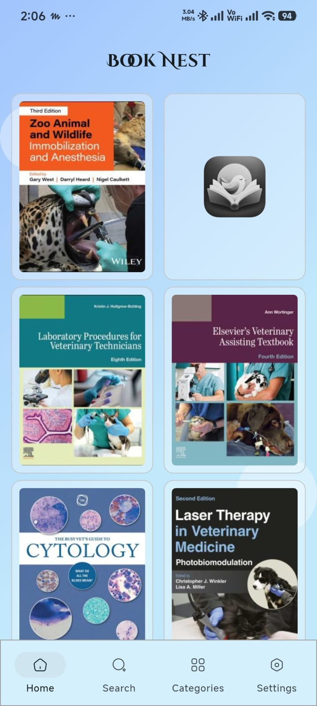
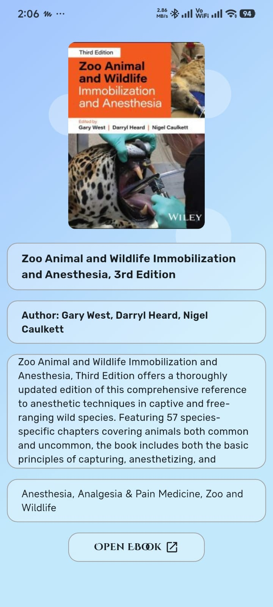
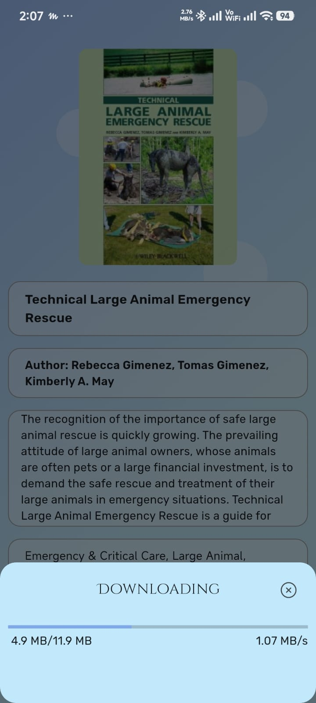
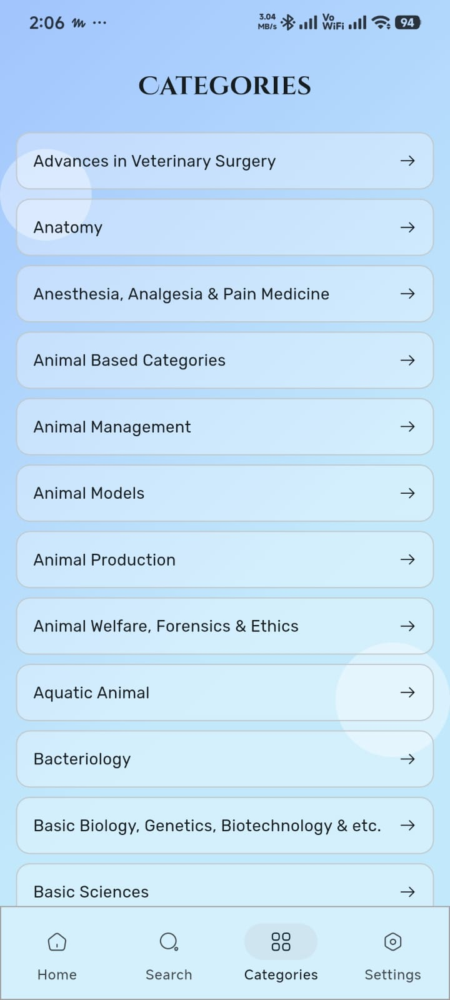
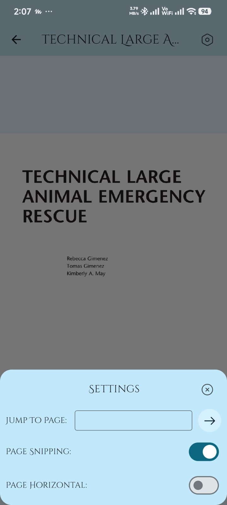
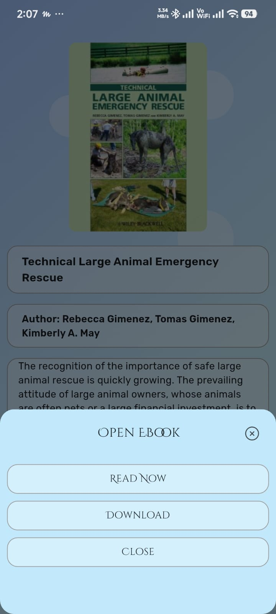

<div align="center">

# BookNest

**A Flutter-based ebook library and PDF reader**

Browse your ebook collection, explore categories, and read downloaded books in a simple mobile interface.

<p>
  
</p>

</div>

---

## About

BookNest is an open-source Flutter project for browsing an ebook collection and reading PDF books on mobile devices. The interface includes Home, Search, Categories, Settings, and a PDF reader with reading controls.

> **Content notice:** BookNest does not claim ownership of books, covers, or other third-party content displayed by the app. Copyright remains with the respective authors, publishers, and rights holders. Only distribute or access content you have permission to use.

## Features

- Browse ebooks in a visual library.
- View book covers in a grid.
- Navigate through Home, Search, Categories, and Settings.
- Open downloaded PDF ebooks.
- Jump to a specific PDF page.
- Configure page snapping and horizontal/vertical reading.
- Flutter and Dart codebase.

*Features may vary depending on the current implementation and configured ebook source.*

## Screenshots

Book covers are displayed as fixed-height thumbnails to keep the README compact.

<table width="100%">
  <tr>
    <td align="center" width="33%">
      <br>
      <sub>Book 1</sub>
    </td>
    <td align="center" width="33%">
      <br>
      <sub>Book 2</sub>
    </td>
    <td align="center" width="33%">
      <br>
      <sub>Book 3</sub>
    </td>
  </tr>
  <tr>
    <td align="center" width="33%">
      <br>
      <sub>Book 4</sub>
    </td>
    <td align="center" width="33%">
      <br>
      <sub>Book 5</sub>
    </td>
    <td align="center" width="33%">
      <br>
      <sub>Book 6</sub>
    </td>
  </tr>
</table>

## Getting started

### Requirements

- Flutter SDK (stable channel recommended)
- Dart SDK compatible with the project's Flutter version
- Android Studio or VS Code with Flutter and Dart extensions
- An emulator or physical device

### Run locally

1. Clone the repository:

   ```bash
   git clone https://github.com/itsdevzam/booknest.git
   ```

2. Enter the project directory:

   ```bash
   cd booknest
   ```

3. Install dependencies:

   ```bash
   flutter pub get
   ```

4. Run the app:

   ```bash
   flutter run
   ```

Replace `YOUR_USERNAME` with your GitHub username, or use your repository's actual clone URL.

## Project structure

```text
booknest/
├── android/
├── assets/
│   ├── font/
│   ├── github_images/
│   └── icon/
├── ios/
├── lib/
├── test/
├── web/
├── windows/
├── linux/
├── macos/
├── pubspec.yaml
└── README.md
```

The exact folders may change as the project develops.

## State management

BookNest uses **Bloc state management** with the `flutter_bloc` package to keep UI widgets separate from application logic and make state changes predictable.

- **Events** represent actions requested by the UI, such as opening an ebook or changing PDF reading settings.
- **Blocs** handle events and coordinate the relevant application logic.
- **States** describe what the UI should display, such as an initial state, download progress/dialog state, a successfully opened PDF, or an error.
- **`BlocBuilder`** rebuilds the relevant UI when the emitted state changes.
- **`context.read<...>().add(...)`** is used to dispatch events from widgets.

The project also uses **`bloc_concurrency`** where needed to control how events are processed. For example, a `droppable()` event transformer can ignore duplicate events while an existing handler is still running.

This separation helps keep widgets focused on presentation while Bloc classes manage event handling and state transitions.

## Dependencies

BookNest is built with Flutter and Dart. It also uses packages for state management, PDF viewing, icons, and other app functionality. See [`pubspec.yaml`](pubspec.yaml) for the current dependency list.

## Open source and book copyrights

Making the **application code** open source does not make the books or cover images bundled with it open source.

- Check the license and redistribution permissions for every book, cover, font, and other asset you include.
- Do not commit copyrighted books unless you have permission or the content is legally distributable.
- Keep third-party attribution and license notices where required.
- If the app retrieves books from an external source, ensure that source and its content are used lawfully.

## Contributing

Contributions are welcome.

1. Fork the repository.
2. Create a feature branch.
3. Make your changes and test them.
4. Open a pull request describing the change.

For substantial changes, consider opening an issue first to discuss the proposed approach.

## License

Choose and add a license before publishing this repository as open source. For example, the MIT License is commonly used for permissively licensed software, but choose it only if it matches your intentions and you have the rights to license all included code.

If you choose MIT, add a `LICENSE` file containing the full MIT license and your copyright notice. A repository without a license generally does not grant others permission to reuse, modify, or redistribute its code.

---

<div align="center">
  Made with Flutter
</div>
